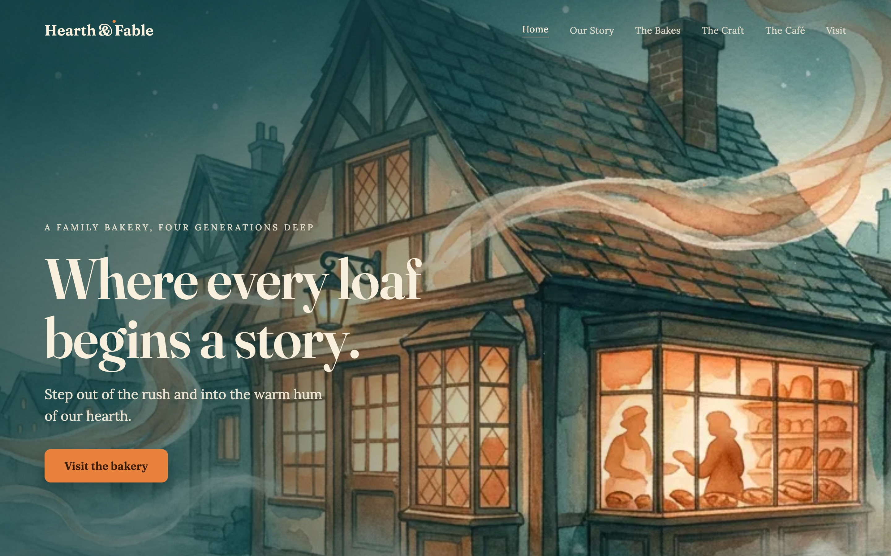

# HEARTH & FABLE — Storybook Bakery Website README

**HEARTH & FABLE** presents a fictional four-generation family bakery as an illustrated fable the visitor scrolls through, built around one promise: *where every loaf begins a story*. The project demonstrates vanilla web development—no frameworks, dependencies, or build tools required.

## Core Concept

The site is a six-page saga—**Home · Our Story · The Bakes · The Craft · The Café · Visit**—where each page opens on a full-bleed watercolor hero and unfolds through sections that never meet in a straight line. The palette shifts with the story: dusk warms into day on Home, the night passes as you scroll through The Craft (`#0D3236 → #123E42 → #174B4F → #1E5A57 → cream`), and every chapter earns its own "magic moment." A doughnut levitates and blooms a halo, a hearth loaf catches a one-time light sweep, a scent-ribbon draws itself down the family history, the café cat's windowsill breathes, the city outside desaturates while the doorway warms, the opening hours light up one by one like lanterns, and a dotted copper route draws from the town gate to the bakery door as you reach the map.

## Technical Highlights

The implementation uses **plain HTML, CSS, and JavaScript** with `IntersectionObserver` and `requestAnimationFrame` for scroll reveals and scroll-bound cinematics. Key features include:

- Standalone pages driven by a single shared motion file—`site.js`—no framework, zero runtime dependencies
- Procedural **watercolor-wash section dividers**: SVG `feTurbulence` + `feDisplacementMap` displace each section's edge so no two sections meet on a straight line
- Reusable **painted-card** component: cream passe-partout, an irregular deckle edge cut with `clip-path` polygons, and a pinned-to-the-wall dot
- rAF-throttled hero parallax, IntersectionObserver reveals, and per-page scroll-bound effects (ribbon draw, night-palette shift, rush-dissolve, lantern hours, map-route draw)
- Particle loops—embers, flour, sugar-dust, steam, smoke—as lightweight CSS keyframes
- One unified driver where every effect self-guards by element presence, so the same file serves all six pages
- Self-hosted assets optimized to **WebP** (≈92% smaller than the source PNGs, ~56 MB → 4.5 MB)
- Hero loads eager with `fetchpriority="high"`; everything below the fold lazy-loads
- Full `prefers-reduced-motion` fallback: loops killed, reveals shown immediately, paths drawn statically
- Responsive with no horizontal overflow across all six pages, verified from mobile to desktop; the header wraps under 760px
- Clean, extensionless URLs served on Vercel

## Design System

A warm storybook palette anchors the brand: **Teal ink** (`#0E4F52`) carries all headings and body over **Cream** (`#FBF3E6`) and **Warm cream** (`#F3E7D2`) surfaces, with dusk sections dropping to **Deep Teal** (`#123E42`). **Copper** is the single accent—`#E0742F` on light, `#E8823C` on dark—held to one primary CTA and no more than one or two accents per viewport. Typography pairs **Fraunces** (optical-sizing on) for the wordmark, headings and CTAs with **Lora** for body and navigation.

## Getting Started

Run locally with any static server: `python3 -m http.server 8731`

**Live site:** [hearth-and-fable.vercel.app](https://hearth-and-fable.vercel.app)

---

Crafted by [WEBDEVCAVEMAN](https://webdevcaveman.com)
